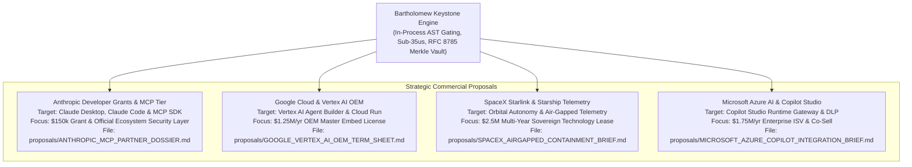

# Bartholomew Trust Protocol (BTP v6.5.7)
## Enterprise & Strategic Technology Licensing Portfolio

This directory contains the executive term sheets, partnership dossiers, and commercial technology licensing frameworks for Bartholomew Keystone and Bartholomew Vault.

---

### Portfolio Overview

---

### Proposal Directory

1. **Anthropic MCP Partnership & Grant Submission**:
   - **Document**: [`docs/enterprise/proposals/ANTHROPIC_MCP_PARTNER_DOSSIER.md`](file:///c:/Users/User/.gemini/antigravity/scratch/autonomous-circularity-network/docs/enterprise/proposals/ANTHROPIC_MCP_PARTNER_DOSSIER.md)
   - **Target**: Claude Desktop, Claude Code, Anthropic MCP Server Ecosystem.
   - **Structure**: Non-dilutive $150,000 USD ecosystem developer grant + certified MCP gateway status.

2. **Google Cloud & Vertex AI OEM Licensing Term Sheet**:
   - **Document**: [`docs/enterprise/proposals/GOOGLE_VERTEX_AI_OEM_TERM_SHEET.md`](file:///c:/Users/User/.gemini/antigravity/scratch/autonomous-circularity-network/docs/enterprise/proposals/GOOGLE_VERTEX_AI_OEM_TERM_SHEET.md)
   - **Target**: Vertex AI Agent Builder and Google Cloud Run.
   - **Structure**: $1.25M USD/year OEM embedded runtime license with per-invocation scaling.

3. **SpaceX Sovereign Technology Lease & Architecture Brief**:
   - **Document**: [`docs/enterprise/proposals/SPACEX_AIRGAPPED_CONTAINMENT_BRIEF.md`](file:///c:/Users/User/.gemini/antigravity/scratch/autonomous-circularity-network/docs/enterprise/proposals/SPACEX_AIRGAPPED_CONTAINMENT_BRIEF.md)
   - **Target**: Starlink autonomous constellation routing, Starship ground telemetry, and autonomous robotics.
   - **Structure**: $2.5M USD 3-year sovereign air-gapped license with zero outbound telemetry requirements.

4. **Microsoft Azure AI & Copilot Studio Integration Brief**:
   - **Document**: [`docs/enterprise/proposals/MICROSOFT_AZURE_COPILOT_INTEGRATION_BRIEF.md`](file:///c:/Users/User/.gemini/antigravity/scratch/autonomous-circularity-network/docs/enterprise/proposals/MICROSOFT_AZURE_COPILOT_INTEGRATION_BRIEF.md)
   - **Target**: Microsoft Copilot Studio and Azure AI Studio.
   - **Structure**: $1.75M USD/year enterprise runtime license + Azure Marketplace Co-Sell managed application.

5. **Foundational OEM Framework**:
   - **Document**: [`docs/enterprise/ENTERPRISE_OEM_LEASING_FRAMEWORK.md`](file:///c:/Users/User/.gemini/antigravity/scratch/autonomous-circularity-network/docs/enterprise/ENTERPRISE_OEM_LEASING_FRAMEWORK.md)
   - **Content**: Detailed architectural comparison against legacy cloud moderation APIs, latency benchmarks, and commercial warranty structures.
